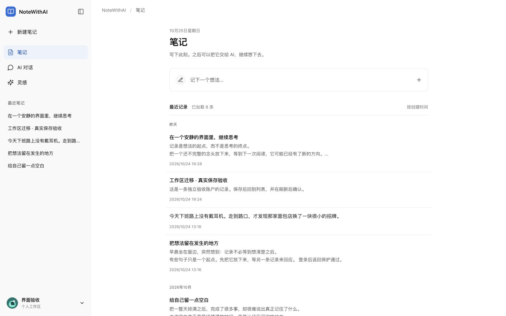
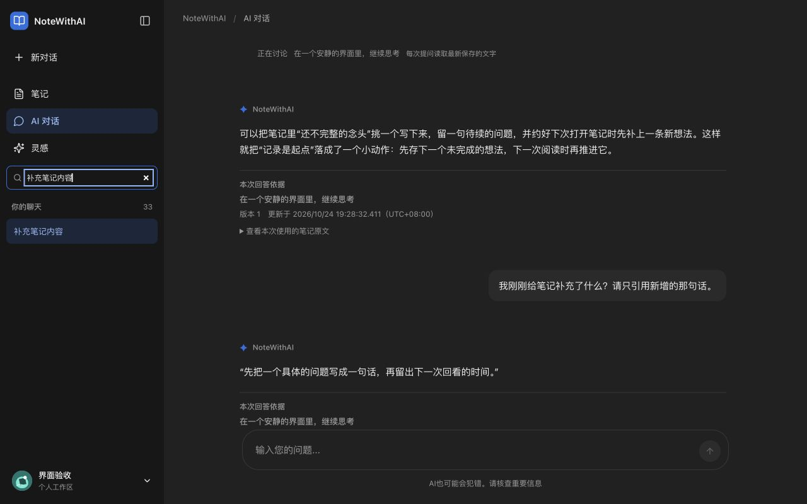
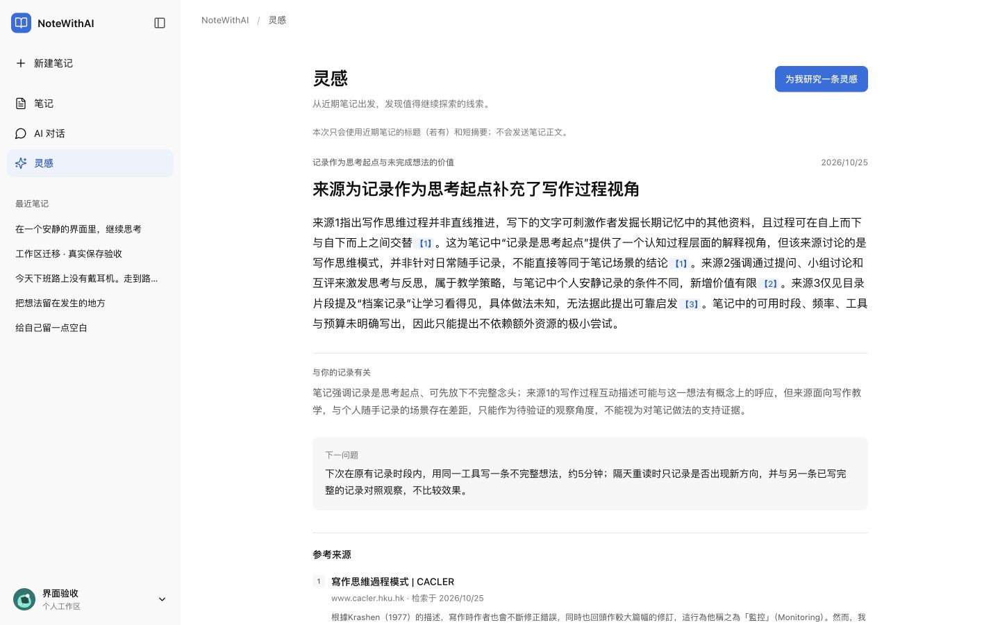
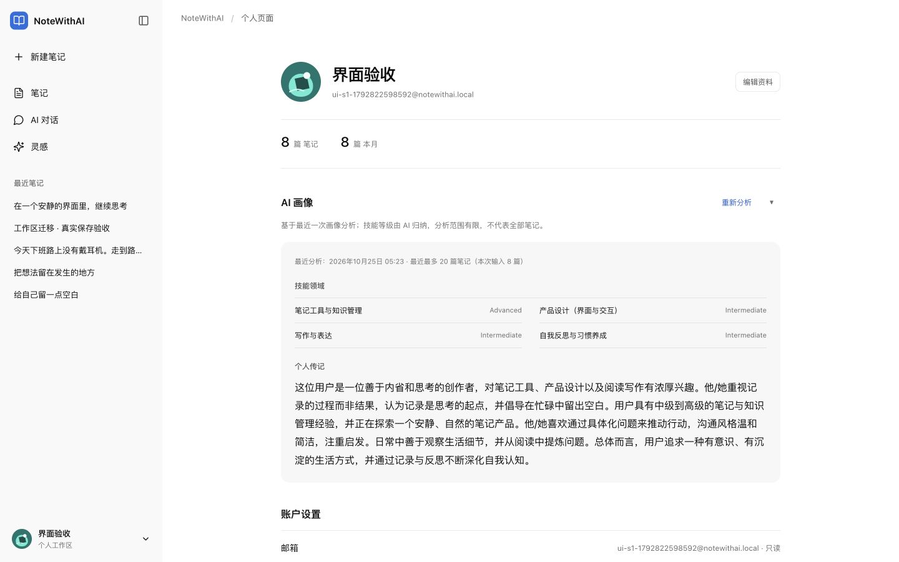
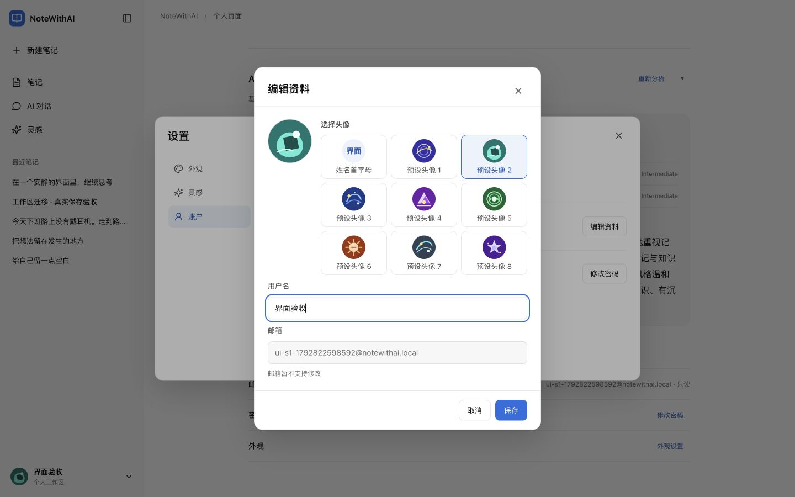

# NoteWithAI 工作区 UI 迁移 S2/S3 验收记录

状态：已完成实施、独立审阅与本机生产浏览器验收，交付后等待用户整体验收。基线为用户已确认的 S1，现行 Spec 为 `../specs/2026-10-24-workspace-ui-migration-design.md`。分支 codex/workspace-ui-migration；没有提交、推送或部署。

## 实施与范围

聊天历史迁入同一公共侧栏，输入/消息/来源/关联区域使用统一构图；笔记阅读可真实建立空消息绑定再开始对话。灵感使用开放阅读/真实三类历史和来源，设置与页面共享唯一服务端 controller。个人页面保留真实两统计、画像和账户能力；设置中的资料与密码使用同一原生弹窗，保留背景任务与未提交保护。主题、字阶、输入圆角和强调色统一，DESIGN.md 已随 S1 更新。

认证与后台 34 个文件对原始实施前快照一致，主稿 HTML SHA-256 仍为 `079a21d0269eee41283d6e7bdea3320038388fa74dc92522330f86ff301ffba8`。最终交付前再核对。

## 最终自动检查

Root 在 frontend 执行 `npm test`：最终 67 文件 564 测试通过（s2s3-postwave-test.log；最后纯CSS后另存handoff日志）；`npm run typecheck` 通过；`npm run lint`：0 errors / 10 warnings。Warnings 包含原图片建议及新增共享头像 img / 测试 helper 依赖建议，没有将其称为零告警。

独立生产副本 `.superpowers/workspace-ui-migration/build-frontend` 执行 build 与 `check:route-budgets` 通过，最终211源文件与工作区哈希一致。预算只代表已配置 notes 路由上限，不扩写为全站性能保证。未停止用户 3000 前端或 3001 后端。

最终独立静态审阅提出的四项 Important 已修正并独立复审关闭。初始空登记补真实状态合同，删除显式会话同步URL，profile保留认证守卫；长历史增加flex并补齐折叠窄抽屉的级联。最后一处纯CSS后Sass、生产build及notes预算重新通过，未声称零lint告警。

## 已完成的真实浏览器操作

IAB 浏览器访问本机 3010 生产副本；通过正常可见登录进入独立本机验收账号，仅使用该账号的笔记/会话/画像/灵感。未用浏览器脚本注入 store/token 或 mock API。截图在 `assets/2026-10-25-workspace-ui-s2-s3/`。

| 情境 | 实际结果 |
| --- | --- |
| 笔记→AI | 阅读“在一个安静的界面里，继续思考”点击和AI讨论，服务端接受真实会话ID，空绑定无虚构AI消息 |
| 首轮流与设置 | 实际发送提问、流处理中开设置；背景 textarea 仍挂载，关闭后完整回答和来源版本可见，刷新已保存回答仍在 |
| 来源快照 | 本次回答依据版本1、毫秒更新时间、可展开真实原文；点击来源后返回恢复会话和未发送草稿 |
| 灵感研究 | 定期关闭时手动研究成功，真实三参考来源、检索时间、相关理由和下一问题 |
| 灵感整理 | 收藏→已保存过滤→取消→忽略→已忽略读取→恢复→最近读取均真实服务成功；来源摘录可展开/收起 |
| 定期设置 | 页面入口直达设置灵感分类，开启获得真实 nextEligibleAt，页面同步开启；关闭并刷新仍关闭，手动入口可用；最终维持关闭 |
| 资料弹窗 | 取消/继续/Escape/放弃均保留输入或正确退出；子层关闭后设置仍在，焦点回编辑资料 |
| 资料保存 | 通过可见头像选项选择 preset02，真实PUT成功后个人页和公共侧栏同时显示同一SVG |
| 个人画像 | 真实统计8篇/本月8篇，分析中→真实画像完成；显示最近最多20篇/本次8篇、时间、文字技能级别，无伪造逐条证据 |
| 桌面阅读 | 1440/1280/1024实际查看，1280文章宽800，1024文章宽700，document无横向溢出；深浅色实际检查 |
| 长历史反例 | 隔离账号幂等增加32条滚动夹具；33会话时实测被裁切，已列最终修复波，不能记作通过 |

## 最后浏览器闭合与验证边界

- F1–F4代码均独立复审PASS。F1真实notes注册的加载/失败/空库/可信投影由真实Query集成测试覆盖；F2删除成功由回归覆盖，浏览器只执行取消以免永久删除验收数据。
- 长历史33条常态滚到底、末条删除弹窗取消、末条选择实际通过。先桌面折叠再980打开抽屉：section/aside均437，list clientHeight345/scrollHeight1404/scrollTop1059.5，末条可达；关闭后焦点回展开侧栏。证据s2s3-f4-browser-pass.json。
- 显式A→历史主动选B，真实Next URL变为/chat；B输入草稿→读B来源→浏览器返回，仍为B且草稿完整。证据s2s3-source-return-pass.json。A长消息往返保留草稿与约90px阅读位置（实测92→89.5px，小幅布局取整），不声称像素完全不变。
- 真实编辑笔记revision1→保存revision2→原会话提问，回答引用新增句，旧回答仍保留revision1原文与时间，新回答为revision2/毫秒更新时间。截图chat-versions-dark-1280.png，数据来自真实服务。
- 1440/1280/1024及980实际检查，1199/1200关联区实际切换：1200为330px并排栏，1199为fixed dialog抽屉，关闭恢复入口。截图已保存。未登录直接/profile实际跳/auth；认证/后台34文件及主稿hash最终重新核对一致。
- 资料头像真实保存后刷新/重新登录仍保留preset02，公共侧栏与个人页一致；密码空表单实际显示“请输入当前密码”，未输入或提交新凭据。
- 密码成功提交涉及新凭据，留用户本人最终人工验证；自动化已覆盖校验、失败保留、保存锁和成功清理登录。不为验收修改实际凭据。
- 未等待24小时调度，也未穷尽所有后端服务故障的端到端场景；相关失败/迟到/冲突由已有定向测试覆盖，区分于实际浏览器证据。

## 实施裁定与代价

1. 以脏工作树新分支和源码快照保留已有功能，不从默认分支重建干净代码；代价是审阅需显式快照，不能用HEAD冒充本次基线。
2. 用户已批准Spec/S1并要求直接继续，不重复设计划审批；代价是如视觉有偏差，在最终用户验收时回改。
3. 聊天/灵感/个人并行且文件责任互斥，公共层由Root拥有；代价是必须集中整合和审阅，不能各自改共享文件。
4. 指定笔记无专属AI开场API，真实保存空消息绑定后由用户提问；代价是该入口没有模拟主稿中的固定AI首问，避免把假消息存入业务。
5. 最近记录兜底只保留真实首五条链接，不填 notes 查询缓存；代价是冷进非notes多一次轻量首屏读取，保证原分页状态不被抢占。
6. F1允许useNotes仅透传既有isSuccess用于区分可信空库，保持请求/缓存/游标算法；代价是调用者测试mock必须遵守真实状态合同。
7. 源码尚未提交，保留恢复账本和审阅包；代价是需随交付保留忽略目录，不能套用“git历史已记录”删除工作目录。

8. 补齐最终审阅后已确认的原F4窄窗CSS残留，并仅复核该增量；代价是多一次CSS构建和复核，避免把不可达历史作为已完成交付。

## 预览、截图与人工检查点

本机预览 [http://localhost:3010/notes](http://localhost:3010/notes)，自有生产进程session15582，依赖用户现有本机3001后端。未提交/合并/部署，分支和已有脏改完整保留。

最后交付后等待用户整体验收，自动接续在此检查点取消，不保留定时任务。恢复账本/源码快照保留，以便用户给出反馈后继续；不使用重置权益或购买额度。

